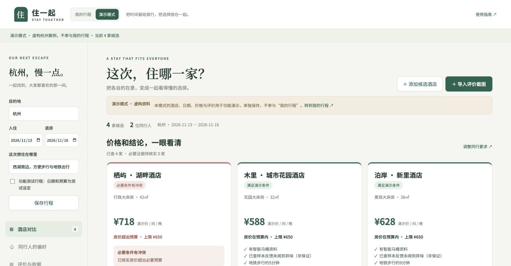

# 住一起 · Stay Together

面向结伴旅行者的 AI 酒店资料整理与决策助手：把同行偏好、酒店房型、平台价格和评价依据放在一起，说明哪些条件已满足、哪些冲突、还缺什么证据。

[在线网站](https://stay-together-yusi-1024.yusinn0613.chatgpt.site/) · [GitHub 仓库](https://github.com/yeyushengfan-nys/stay-together) · [项目进度](PROJECT_STATUS.md)

本仓库是已部署网站 **v51** 的源码导出，来源提交 **`59a905f`**；Chrome 采集扩展版本为 **0.2.7**。部署版本、扩展版本和 `package.json` 的 `0.1.0` 是不同编号。最新验证结果与统计口径以 [PROJECT_STATUS.md](PROJECT_STATUS.md) 为准。



## 先运行页面

安装 Node.js **22.13.0 或以上**，下载或克隆仓库后，在项目目录执行：

```sh
node scripts/preview-hotel.mjs
```

打开终端显示的 **http://127.0.0.1:8130/**。这条路径使用 Node 内建模块，**不用安装项目依赖，不读取密钥，不调用付费 AI**。可查看界面、填写同行偏好、导入截图和体验明确标注的虚构演示；它不是完整后端部署。停止预览：在终端按 `Ctrl+C`。

## 当前范围

| 部分 | 当前能力与限制 |
| --- | --- |
| 网页 | 管理行程、同行偏好、候选及证据；“我的行程”和虚构演示使用独立本地存储。 |
| Chrome 扩展 | 在用户自己的 Chrome 中读取携程、同程可见房型页参考价、早餐和取消文字；登录、验证码及访问异常会暂停。当前配置仅连接项目线上域名。 |
| AI 后端 | 整理截图、解释评价、结合逐人偏好形成核实清单，并校验条件与引用。线上付费调用仅开放给配置的所有者账号；克隆源码不会取得网站的密钥或权限。 |
| 决策边界 | 参考价用于初筛，不等于最终含税应付价；套餐不同不标“最低价”。最近记录的真实模型测试输出了核实候选，**正式入住首选／备选为 0**，原因是必要证据仍不足。 |
| 尚未交付 | 免登录的完整 AI Demo、飞猪／去哪儿自动完整报价、多人实时同步、微信小程序均未完成或发布。 |

截图存于当前浏览器的 IndexedDB，行程、偏好及已接受结果存于 localStorage；分享网址不会同步这些资料。点击 AI 分析时，相应材料才会发送至配置的服务端及模型服务。自动查价需要使用者自己的平台登录，由使用者处理验证码，不提交订单或付款。

## 代码位置

- `public/`：主要网页、偏好与条件检查、报价证据及结果展示。
- `collector-extension/`：Chrome Manifest V3 扩展及平台页面读取逻辑。
- `lib/`、`app/api/`、`worker/`：AI、酒店搜索接口和 Cloudflare Worker 入口。
- `tests/`、根目录 `test-*`：离线规则、引用、页面状态及模拟接口回归。
- `docs/`：运行说明和已脱敏的历史验证材料；历史价格不是当前报价。

开发运行、环境变量和扩展迁移见 [docs/RUNNING.md](docs/RUNNING.md)。公开源码范围与排除项见 [docs/PUBLICATION.md](docs/PUBLICATION.md)。

## 离线检查

以下脚本已包含在仓库中，使用固定材料或测试替身，不调用真实 AI 或订房接口：

```sh
node tests/test-verification-shortlist.mjs
node tests/test-evidence-preservation.mjs
node tests/test-quote-handoff.mjs
node tests/test-tongcheng-loading.mjs
node tests/test-ai-request-lifecycle.mjs
node tests/test-decision-ui.mjs
```

离线回归通过只证明这些测试断言成立，不能代表平台始终可采集、模型普遍准确或用户已经节省时间。不要把 `scripts/test-live-research.mjs` 等现场脚本当作离线测试运行。

本次公开副本验证：34 个离线测试脚本通过；无依赖预览的 5 个 HTTP 路径返回 200；使用既有依赖的框架构建通过。未测试一次全新依赖安装，未调用真实 AI。详见 [检查记录](docs/public-source-checks.json)。
